# Recovery 2 — recuperador de archivos con explorador · Delio

Programa para **recuperar archivos de un equipo con Windows que fue restaurado,
formateado o del que se borraron archivos**, con un explorador para **ver lo
encontrado antes de recuperarlo**, como los programas comerciales:

- Busca los archivos **con su nombre y su carpeta original** (la tabla de
  archivos de NTFS actual y los restos de la que había antes de restaurar).
- Encuentra además **por su contenido** fotos, videos, documentos, música y
  comprimidos cuyo nombre ya no existe.
- Muestra todo en un **árbol de carpetas** con **vista previa** de fotos y
  textos, un **buscador** y **casillas** para elegir qué recuperar.
- Indica el **estado de cada archivo** (bueno, dañado en parte, en blanco, no recuperable).
- **Crea una imagen del disco** tolerante a sectores dañados y reanudable, para
  trabajar sobre la copia y no sobre el disco del cliente (imprescindible en SSD/NVMe).
- Incluye dos herramientas: **estado de los discos** y **programas que más ocupan**.
- **Solo lee** el disco afectado. Nunca escribe en él.
- Con la imagen de **Delio** ([delioph.tech](https://delioph.tech)): los
  mismos colores, letra, botones y onda que la página, y un **modo noche**.

Es un único archivo (`recovery.exe`), no se instala y no necesita nada más.

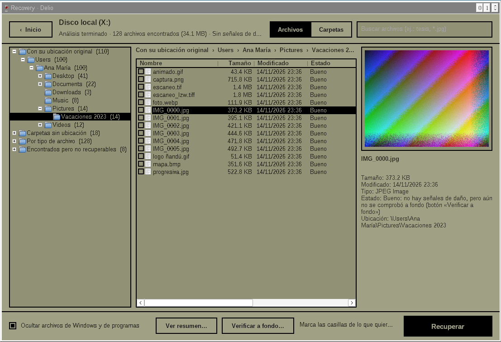

---

## Antes de empezar (importante)

1. **Usa el equipo afectado lo menos posible.** Cada archivo nuevo que se guarda
   en ese disco puede sobrescribir para siempre algo recuperable.
2. **Necesitas otro disco** (externo o USB) para guardar lo recuperado. El
   programa no deja guardar en la misma unidad que se analiza.
3. **No descargues `recovery.exe` en el disco afectado**: cópialo a la memoria
   USB o al disco externo desde otro equipo y ejecútalo desde ahí.

## Lo más importante: haz primero una imagen del disco

Recuperar directamente desde el disco del cliente es arriesgado: si se ejecuta
dentro de su Windows, Windows sigue escribiendo y pisa lo que se quiere salvar;
si el disco está fallando, cada lectura lo desgasta; y en los **SSD (NVMe o
SATA)** el propio disco puede seguir vaciando lo borrado mientras está encendido
(TRIM). Lo profesional es **copiar el disco entero a un archivo de imagen una
sola vez** y recuperar desde la imagen todas las veces que haga falta.

1. **No arranques el Windows del cliente.** Apaga el equipo y saca el disco.
   Para un NVMe usa una caja o adaptador **USB para NVMe M.2** y conéctalo a tu
   equipo (o ponlo como segundo disco en tu PC).
2. *(Opcional, máxima seguridad)* Antes de conectarlo, en una consola de
   administrador: `diskpart` → `san` (anota el valor) → `san policy=OfflineAll`.
   Así Windows no monta ni escribe en los discos nuevos. Al terminar, vuelve a
   poner el valor anotado.
3. En Recovery elige el **«Disco físico …»** y pulsa **«Crear imagen del disco…»**.
   Elige una carpeta en otro disco **formateado en NTFS**: en NTFS las zonas
   vacías del disco no ocupan sitio. En exFAT también funciona, pero la imagen
   ocupa **siempre el tamaño completo** del disco de origen (y tarda más); el
   programa lo avisa y comprueba que quepa. FAT32 no sirve.
4. Al terminar, pulsa **«Analizar la imagen»** (o más tarde **«Abrir imagen…»**)
   y recupera desde ahí. El disco del cliente ya puedes desconectarlo.

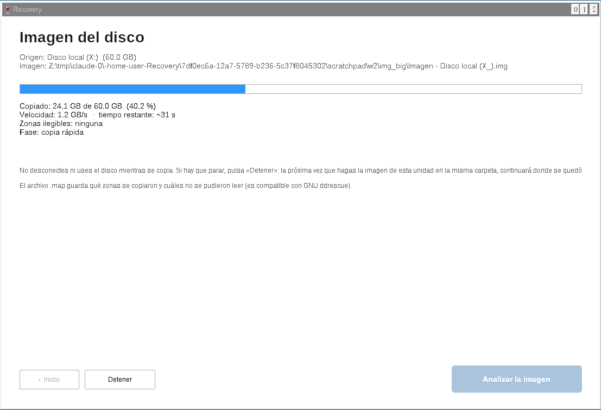

- Se puede **detener y continuar**: vuelve a elegir la misma unidad y la misma
  carpeta y sigue donde se quedó.
- Los sectores que no se pueden leer quedan a cero en la imagen y se anotan en
  el archivo `.map` (formato de GNU ddrescue, por si algún día quieres seguir
  con esa herramienta).
- **Si Windows pide la clave de BitLocker al conectar el disco**, estaba cifrado.
  La clave de recuperación suele estar en la cuenta Microsoft del dueño
  (account.microsoft.com/devices/recoverykey). Desbloquéalo y haz la imagen de su
  **letra de unidad**, no del disco físico (el programa también lo avisa).

## Cómo usarlo

1. Haz doble clic en `recovery.exe` y acepta el permiso de administrador (hace
   falta para leer el disco). Si aparece «Windows protegió su PC», pulsa
   **Más información → Ejecutar de todas formas** (sale porque el programa no
   está firmado por una empresa).
2. En la pantalla de inicio elige la unidad donde estaban los archivos
   (normalmente **C:**) y pulsa **Buscar archivos**.
   - Deja **sin marcar** «Análisis rápido» si el equipo se formateó o
     restauró: así se analiza el disco entero (puede tardar horas).

   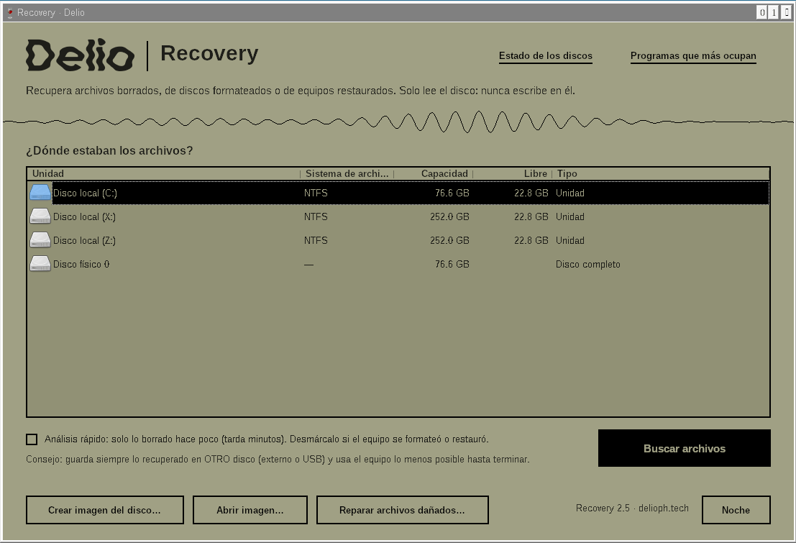

   El botón **Noche** (abajo a la derecha) cambia a los colores invertidos,
   como en la página; la elección se recuerda para la próxima vez.

   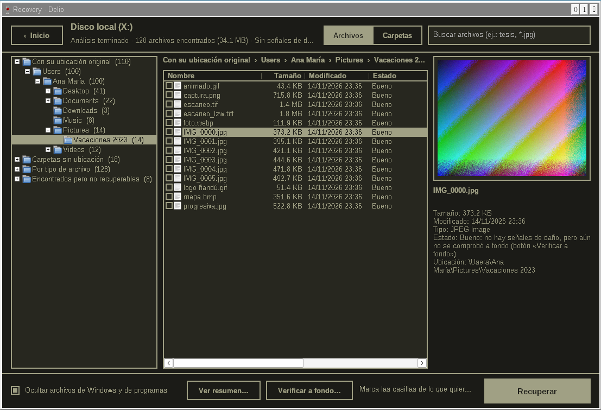

3. Los archivos **van apareciendo mientras se analiza**: ya puedes explorarlos.
   Pulsa **Detener** cuando quieras para quedarte con lo encontrado.

   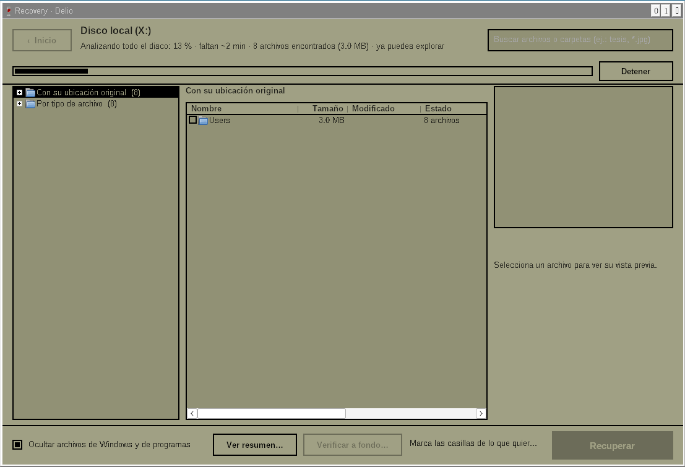

4. Explora a la izquierda y selecciona un archivo para ver su **vista previa**
   y su estado a la derecha. Usa el **buscador** de arriba a la derecha.
5. **Marca las casillas** de los archivos o carpetas que quieres (marcar una
   carpeta marca todo su contenido) y pulsa **Recuperar**. Elige una carpeta en
   **otro disco** y, al terminar, el programa te ofrece abrirla.

### Las secciones del explorador

| Sección | Qué contiene |
|---------|--------------|
| **Con su ubicación original** | Archivos con su nombre y su ruta, por ejemplo `\Users\Ana\Documents\...` |
| **Carpetas sin ubicación** | Carpetas completas cuya carpeta superior ya no existe (`carpeta_1234`) |
| **Por tipo de archivo** | Todo lo recuperable agrupado: fotos, videos, audio, documentos… y por extensión |
| **Sin nombre (por contenido)** | Archivos encontrados por su contenido, sin nombre original, agrupados por tipo |
| **Encontrados pero no recuperables** | Archivos que existían pero su contenido ya fue sobrescrito (solo informativo) |

La casilla **«Ocultar archivos de Windows y de programas»** (marcada por
defecto) deja solo los archivos personales; desmárcala para verlo todo.

El botón **«Ver resumen…»** muestra, con porcentajes, cuántos archivos están
verificados, sin comprobar, dañados, en blanco o perdidos (y sus GB). Al
recuperar, ese mismo resumen se guarda como `resumen.txt`.

El botón **«Verificar a fondo…»** lee entero cada archivo (los marcados, o todos
si no hay nada marcado) y comprueba su contenido: sumas de control de ZIP/Office
(docx, xlsx, pptx), PNG, PDF y OGG; decodificación completa de JPG y GIF;
registros internos de Excel, PowerPoint y Word 97-2003; páginas de SQLite;
fotogramas de MP4/MOV (H.264/H.265) y MKV; paquetes de WMV/WMA, TS/MTS y MP3;
y que los textos sigan siendo texto. **Antes de prometerle un porcentaje al
cliente, verifica a fondo**: es lo único que distingue «parece bueno» de
«está bien». Al recuperar se hace la misma comprobación sobre lo guardado y lo
dañado va a la carpeta `Dudosos`.

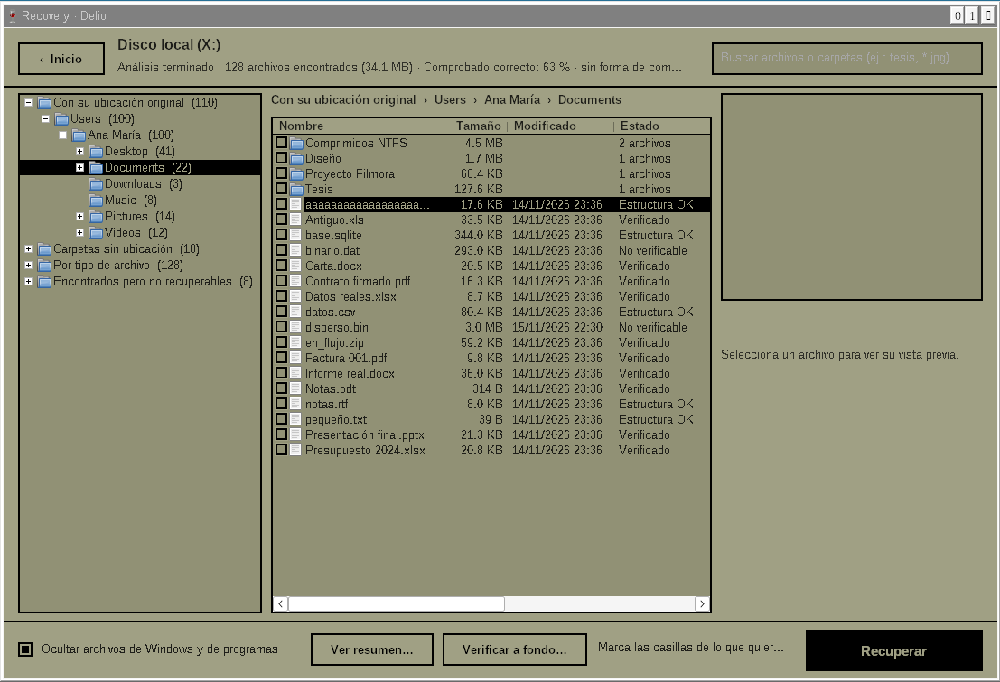

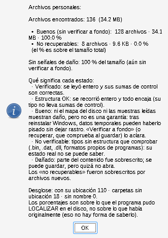

### El buscador

Junto a la casilla de búsqueda eliges qué buscar: **Archivos** (por defecto) o
**Carpetas**. Para archivos, escribe en la casilla:

| Ejemplo | Encuentra |
|---------|-----------|
| `tesis` | archivos o carpetas cuyo nombre contiene «tesis» |
| `*.jpg` | todas las fotos JPG (también vale `*.docx`, `*.mp4`…) |
| `Vacaciones 2023` | todo lo que está dentro de esa carpeta |
| `tesis, *.mp4` | varias cosas a la vez, separadas por comas |

No distingue mayúsculas ni acentos («mama» encuentra «Mamá»).

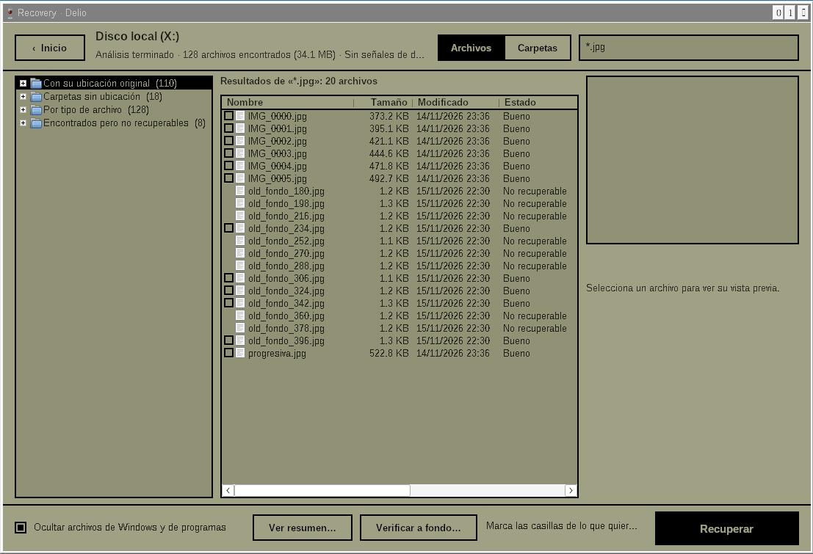

### Buscar una carpeta en concreto

Cuando lo que importa es **una carpeta entera** (la de la empresa, la
contabilidad, un proyecto), pulsa **Carpetas** y escribe su nombre: `Empresa`,
`Contabilidad 2024`, `Contab*` o un trozo de ruta como `Documents\Empresa`
(varias, separadas por comas; sin distinguir mayúsculas ni acentos).

- La lista muestra **cada carpeta que coincide, esté donde esté**: con su
  ubicación original, en «Carpetas sin ubicación» (si se perdió la carpeta de
  encima) o entre los no recuperables. Primero las que se llaman exactamente así,
  luego las que empiezan así y luego las que lo contienen; entre iguales, la que
  más archivos tiene. Si hay varias copias, compara la **ubicación**, el número
  de archivos y la fecha de **Modificado** (la del archivo más reciente que
  contiene).
- Al elegir una, el panel de la derecha dice **cuánto se puede recuperar de
  ella**: archivos, tamaño, subcarpetas, último cambio, porcentaje sin señales de
  daño y cuántos archivos suyos están dañados, en blanco o ya no se pueden
  recuperar.
- **Marca su casilla** para recuperarla entera, con todas sus subcarpetas, o haz
  doble clic para abrirla. «Verificar a fondo» comprueba lo marcado.
- Si la carpeta **perdió su nombre** (tras reinstalar, Windows puede reutilizar
  la ficha de la carpeta y sus archivos aparecen en «carpeta_123»), escribe el
  nombre de algún archivo que tenía dentro: después de las carpetas que se
  llaman así aparecen **las carpetas que contienen archivos con ese nombre**,
  ordenadas por cuántos tienen. También sirve buscar el archivo en «Archivos» y
  hacer **doble clic**: se abre la carpeta donde está.
- Al recuperar, `resumen.txt` incluye un informe de cada carpeta recuperada
  entera, útil para entregárselo al cliente.

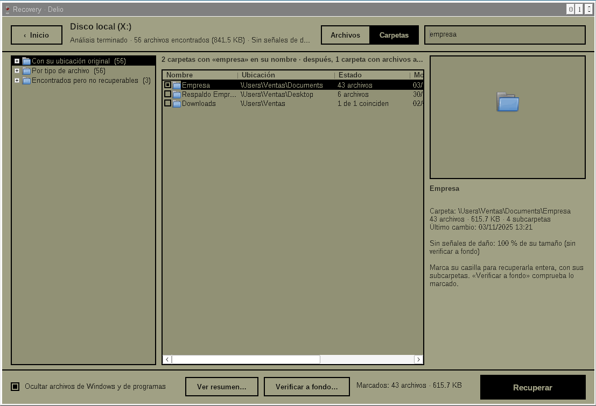

### Estado de cada archivo

- **Verificado**: se leyó entero y sus sumas de control (o su decodificación)
  son correctas. Saldrá exactamente como estaba.
- **Estructura OK**: se recorrió entero y todo encaja; su tipo no lleva sumas
  de control (txt, csv, mp3, wav, avi, doc…), así que es muy probable pero no
  100 % seguro.
- **Bueno**: ni el mapa del disco ni las muestras leídas muestran daño, pero
  **aún no se comprobó a fondo**. Tras una reinstalación de Windows, archivos
  temporales pueden haberlo pisado sin dejar rastro: pulsa «Verificar a fondo».
- **No verificable**: ya se intentó comprobar, pero es de un tipo sin estructura
  que mirar (.bin, .dat, .dll, formatos propios de programas). Su estado real no
  se puede saber hasta abrirlo.
- **Dañado**: su contenido no corresponde (sobrescrito por otros datos).
- **Dañado en parte**: parte de su contenido fue reutilizado por archivos nuevos;
  puede abrir a medias.
- **Puede estar incompleto**: encontrado por su contenido pero estaba
  fragmentado.
- **En blanco**: el archivo existe, pero el disco ya vació su contenido (lo
  hacen los SSD con TRIM, y también «limpiar la unidad» al restablecer Windows).
  No se puede recuperar con ningún programa; el explorador lo detecta leyendo
  unas muestras de cada archivo y así sabes desde el principio qué se puede salvar.

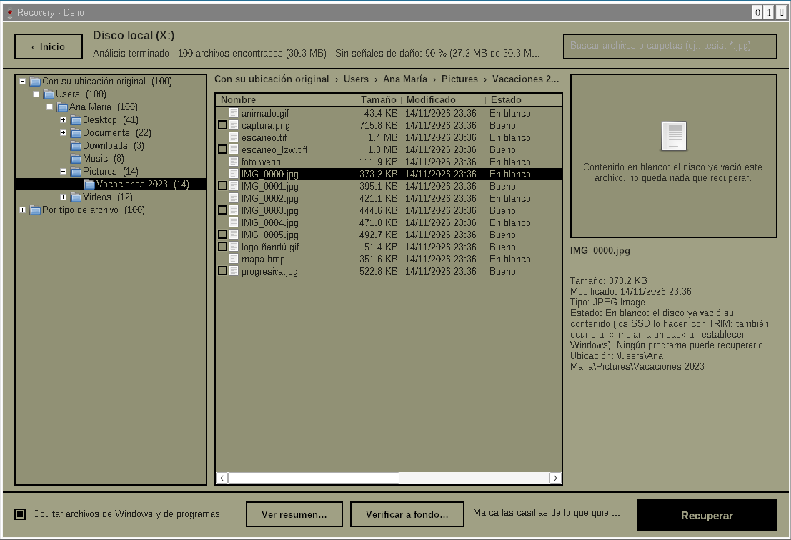
- **No recuperable**: el archivo existía pero su contenido ya no está.

## Herramientas

**Estado de los discos** muestra cada disco con su tipo (SSD/HDD), conexión,
salud según Windows, temperatura, desgaste del SSD, horas de uso y errores de
lectura, con un veredicto (**Bueno / Atención / Mal**) y el espacio libre de
cada unidad.

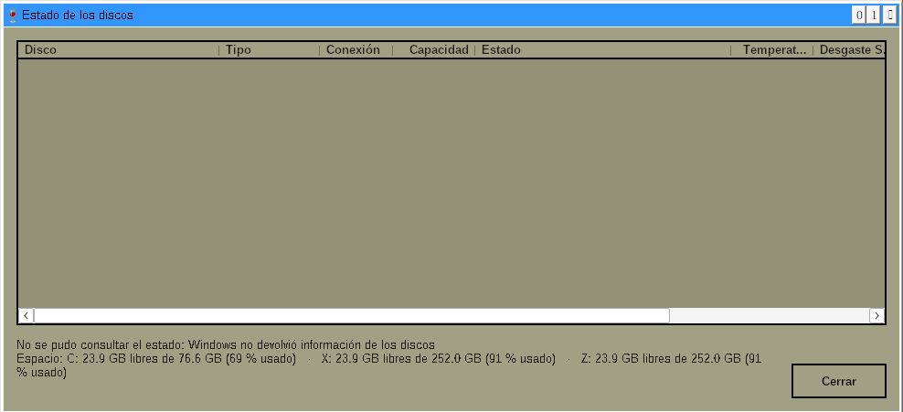

**Programas que más ocupan** lista los programas instalados de mayor a menor,
midiendo lo que ocupa realmente su carpeta (con «~» cuando solo se conoce el
tamaño que declaró el instalador). Haz clic en una columna para ordenar.

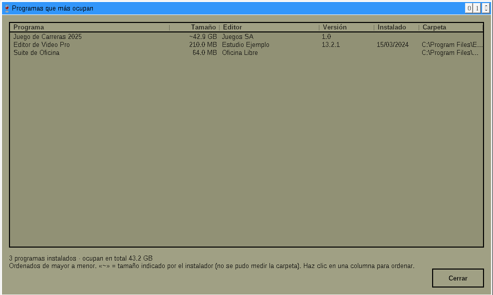

## Dónde quedan los archivos recuperados

Dentro de la carpeta que elijas se crean:

| Carpeta | Contenido |
|---------|-----------|
| `Archivos` | Archivos con su ruta original |
| `Carpetas_sueltas` | Carpetas cuya carpeta superior ya no existía |
| `Por_firma` | Archivos sin nombre, por tipo (las fotos y videos se nombran con su fecha cuando la tienen) |
| `Dudosos` | Archivos dañados en parte o incompletos: puede que no abran |

## Preguntas frecuentes

**¿Por qué aparece un archivo pero sale «dañado» o «no recuperable»?** El nombre
y el contenido se guardan en sitios distintos del disco. Tras una restauración
suele sobrevivir la «ficha» del archivo pero no su contenido, si el Windows nuevo
reutilizó ese espacio.

**Mi disco es un SSD o NVMe.** En los SSD, Windows suele vaciar físicamente (TRIM)
el contenido de lo borrado: quedan los nombres pero el contenido son ceros, y
**ningún programa** puede recuperarlo. Haz la imagen cuanto antes; el explorador
marcará como «En blanco» lo que ya no tiene contenido. Si lo que necesitas está
en blanco, la única vía es otra copia: la nube del cliente (OneDrive guarda lo
borrado 30 días en su papelera y tiene historial de versiones; con Microsoft 365
permite «Restaurar OneDrive» a una fecha anterior), correos con adjuntos, memorias
USB u otros equipos de la empresa.

**La unidad está cifrada con BitLocker.** Elige la **letra de unidad** (`C:`)
con la unidad desbloqueada, no el «Disco físico».

**¿Tenía archivos en OneDrive?** Los que estaban «solo en la nube» no ocupaban
sitio en el disco y siguen en tu cuenta de OneDrive.

**¿Existe `C:\Windows.old`?** Mira primero en `C:\Windows.old\Users`: ahí
Windows deja a veces los archivos anteriores tal cual.

**No aparece mi unidad o se cambiaron las particiones.** Elige «Disco físico …»:
el programa localiza por sí mismo dónde empezaba el volumen antiguo.

## Uso avanzado (línea de comandos)

Con opciones, el programa trabaja por consola en vez de abrir la ventana. Abre
una consola **como administrador**:

```
recovery.exe -origen disco1 -imagen E:\Imagenes
recovery.exe -origen "E:\Imagenes\Imagen - disco1.img" -destino F:\Recuperado -buscar "tesis, *.jpg"
recovery.exe -origen "E:\Imagenes\Imagen - disco1.img" -destino F:\Recuperado -carpeta "Empresa" -solo-listar
recovery.exe -estado-disco
recovery.exe -programas
```

| Opción | Efecto |
|--------|--------|
| `-origen X` | `C:`, `disco0`, `\\.\PhysicalDrive0`, un archivo de imagen (`disco.img`) o en Linux `/dev/sdb1` |
| `-destino DIR` | Carpeta de destino (en otra unidad) |
| `-imagen CARPETA` | Crea (o continúa) una imagen del origen en esa carpeta |
| `-buscar TEXTO` | Recupera solo lo que coincida (mismas reglas que el buscador) |
| `-carpeta NOMBRE` | Recupera solo esa carpeta entera, con sus subcarpetas, esté donde esté (`Empresa`, `"Contabilidad 2024"`, `Contab*`, `Documents/Empresa`). Antes de recuperar muestra dónde la encontró y cuánto queda de cada una; con `-solo-listar` solo lo muestra |
| `-modo todo` | Incluye también archivos de Windows y de programas |
| `-rapido` | Solo archivos borrados hace poco |
| `-sin-firmas` / `-solo-firmas` | Solo con nombre / solo por contenido |
| `-solo-listar` | Analiza sin recuperar todavía |
| `-ext jpg,mp4` | Solo esas extensiones |
| `-estado-disco` | Muestra el estado de los discos |
| `-programas` | Muestra los programas que más ocupan |
| `-nuevo` | No reutiliza un análisis anterior |
| `-si` | No pide confirmaciones |
| `-listar` | Muestra las unidades |

## Cómo funciona

1. **Sistema de archivos actual.** Lee la MFT de NTFS: los registros libres que
   conservan datos son archivos borrados, y el mapa de clusters indica qué
   zonas ocupan los archivos actuales (ahí no hay nada perdido).
2. **Análisis completo.** Recorre el espacio libre buscando registros MFT de
   antes de la restauración, sectores de arranque antiguos y cabeceras de
   archivos conocidos. Los resultados se publican por etapas.
3. **Reconstrucción.** Une los fragmentos de los archivos muy fragmentados,
   rehace el árbol de carpetas y averigua dónde empezaba el volumen antiguo.
4. **Archivos sin nombre.** Calcula el tamaño real de cada archivo encontrado
   por su firma analizando su estructura interna.
5. **Recuperación.** Copia lo marcado siguiendo su lista de fragmentos (admite
   archivos fragmentados, dispersos y con compresión NTFS) y comprueba cada uno.

Formatos reconocidos por contenido: JPG, PNG, GIF, BMP, TIFF y RAW, HEIC, WEBP,
PSD · MP4, MOV, 3GP, AVI, MKV, WEBM, WMV, TS, MTS · MP3, WAV, M4A, WMA, OGG,
OPUS · PDF, DOCX, XLSX, PPTX, DOC, XLS, PPT, ODT, RTF, EPUB · ZIP, RAR, 7Z ·
SQLite, PST. Los archivos que conservan su registro NTFS se recuperan sean del
tipo que sean.

## Exactitud medida

`pruebas/prueba_exactitud.py` compara, archivo por archivo, el estado que
muestra el programa con el archivo original real (SHA-1). Resultados en seis
escenarios (borrado, formateo, reinstalaciones, TRIM, disco con particiones):

| Estado | Acierto (el archivo sale idéntico al original) |
|--------|-----------------------------------------------|
| Verificado / Estructura OK | **100 %** en los 6 escenarios (0 errores en 497 archivos) |
| Bueno (solo análisis rápido) | 99–100 % en 5 escenarios; **61 %** en el peor caso (reinstalación que pisa sin dejar rastro) |
| Dañado / En blanco | 0 falsas alarmas |

En el peor caso, antes de esta versión «Bueno» acertaba solo el **4.5 %** y el
resumen decía «100 % en buen estado» cuando en realidad era 0 %. Ahora el
resumen dice «comprobado correcto: 0 %», que es la realidad; lo que queda sin
comprobar son archivos .bin/.dat sin estructura.

Con daños hechos a propósito sobre archivos reales sanos (un bloque de 4 KB
ajeno a mitad del archivo / 64 KB ajenos / el último 30 % en blanco), la
verificación a fondo los detecta así (entre paréntesis, cuántos archivos se
probaron de ese tipo):

- **100 % de los tres daños**: docx (8), xlsx (10), pptx (5), xls (17), zip (12),
  jpg (9), png (21), gif (5), sqlite (11), txt/xml/csv (81), ts (40), mp3 (2);
  mkv, webm, mov, avi, wmv, wma, opus y mts también, pero con solo 1 archivo de
  cada uno (muestra pequeña).
- **pdf** (13): 77 % / 92 % / 100 %. **doc** (10): 80 % / 100 % / 100 %.
  **mp4** (4): los de video H.264/H.265 sí; los que no llevan ese video, no.
- **Solo si el daño rompe la estructura**: ppt (12 %), m4a, wav, tif, psd,
  webp, rar y 7z. Sus datos no llevan sumas de control (o haría falta
  descomprimirlos), así que un trozo pisado en medio puede pasar desapercibido.

Pasado por más de 100 000 archivos reales sanos, no marcó ninguno como dañado
(0 falsas alarmas).

## Limitaciones

- No puede recuperar lo físicamente sobrescrito ni lo vaciado por TRIM.
- Los archivos sin nombre muy fragmentados salen incompletos (`Dudosos`) o no salen.
- En unidades FAT32/exFAT solo funciona la búsqueda por contenido.
- No descifra BitLocker ni EFS (hay que desbloquear la unidad antes).
- La vista previa muestra fotos JPG, PNG y GIF y archivos de texto.
- El estado de los discos usa la información de Windows (Windows 8 o posterior);
  en discos USB suele no estar disponible.
- Verificado con imágenes NTFS reales y ejecutando el `.exe` en Wine (la
  ventana, la recuperación y las herramientas). **No se ha podido probar en un
  Windows real con un disco físico.**

## Compilar y probar

Hace falta [Go](https://go.dev/dl/) 1.21 o posterior. No tiene dependencias.
El icono y el manifiesto de Windows están en `rsrc_windows_amd64.syso`
(generado desde `winres/icon.png`, el símbolo de Delio, con `go-winres`). El
logotipo que se ve en la pantalla de inicio está en `marca/` (sale de los
logos del repositorio de la página). Los colores de la marca están al
principio de `gui_theme_windows.go`, igual que en `css/base.css` de la página:
para cambiar el aspecto de todo el programa basta con tocarlos ahí.

```
GOOS=windows GOARCH=amd64 go build -trimpath -ldflags "-s -w -H windowsgui" -o recovery.exe .
go test ./...
```

Pruebas de extremo a extremo (Linux, como root; requieren `ntfs-3g`, `ffmpeg`,
ImageMagick, `7z`, `rar` y Pillow):

```
go build -o /tmp/recovery .
python3 pruebas/gen_muestras.py /tmp/muestras
python3 pruebas/prueba_firmas.py /tmp/recovery /tmp/muestras /tmp/trabajo
python3 pruebas/prueba_ntfs.py   /tmp/recovery /tmp/muestras /tmp/trabajo
RECOVERY_TEST_IMG=/tmp/trabajo/borrado_win.img RECOVERY_TEST_SRC=/tmp/muestras go test -run TestSessionImage -v .
python3 pruebas/prueba_exactitud.py /tmp/trabajo [--profundo]   # exactitud de los estados
RECOVERY_VAL_DIR=/usr/share go test -run TestValidateDir -v .     # falsas alarmas con archivos sanos
RECOVERY_DET_DIRS=/usr/share go test -run TestDetect -v .         # detección de daños por tipo
```
