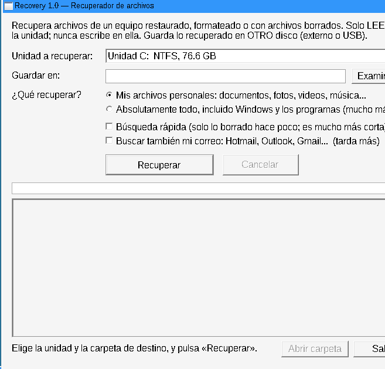
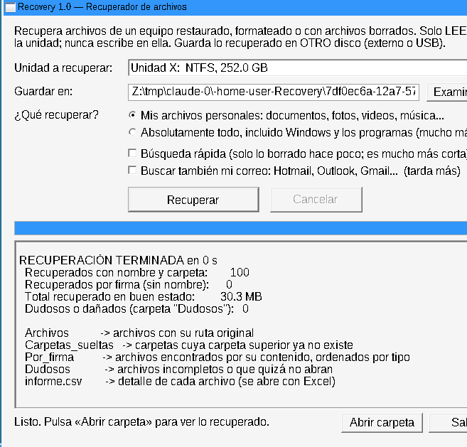

# Recovery — recuperador de archivos perdidos

Programa para **recuperar archivos de un equipo con Windows que fue restaurado,
formateado o del que se borraron archivos**. Hace lo mismo que los programas de
recuperación comerciales:

- Encuentra los archivos **con su nombre y su carpeta original** leyendo la
  tabla de archivos de NTFS (la actual y los restos de la anterior a la
  restauración).
- Además busca **por contenido** (fotos, videos, documentos, música,
  comprimidos…) todo aquello cuyo nombre ya no existe.
- Puede **buscar direcciones de correo** (Hotmail, Outlook, Gmail…) escritas en
  el disco, para ayudarte a recuperar una cuenta antigua.
- Comprueba cada archivo y **separa los que salieron bien de los dañados**.
- **Solo lee** el disco afectado. Nunca escribe en él.

Tiene una **ventana sencilla** (basta con hacer doble clic) y también funciona
por línea de comandos. Es un único archivo (`recovery.exe`), no se instala y no
necesita nada más.



---

## Antes de empezar (importante)

1. **Usa el equipo afectado lo menos posible.** Cada archivo nuevo que se guarda
   en ese disco (descargas, instalaciones, actualizaciones) puede sobrescribir
   para siempre algo recuperable.
2. **Necesitas otro disco** (externo o USB) con espacio libre para guardar lo
   recuperado. El programa se niega a guardar en la misma unidad que analiza.
3. **No descargues `recovery.exe` en el disco afectado.** Descárgalo en otro
   equipo, cópialo a la memoria USB o al disco externo y ejecútalo desde ahí.

## Cómo usarlo (ventana)

1. Copia `recovery.exe` al disco externo o memoria USB y conéctalo al equipo.
2. Haz doble clic en `recovery.exe`. Windows pedirá permiso de administrador
   (hace falta para leer el disco): responde **Sí**.
   - Si aparece “Windows protegió su PC”, pulsa **Más información → Ejecutar de
     todas formas** (sale porque el programa no está firmado por una empresa).
3. En la ventana:
   - **Unidad a recuperar:** elige la unidad (normalmente `C:`).
   - **Guardar en:** pulsa **Examinar…** y elige una carpeta del disco externo,
     por ejemplo `E:\Recuperado` (tiene que estar en OTRA unidad).
   - **¿Qué recuperar?:** «Mis archivos personales» (recomendado) o «todo».
   - Marca **«Buscar también mi correo»** si quieres encontrar tu dirección de
     Hotmail/Outlook/Gmail antigua.
4. Pulsa **Recuperar** y espera. La búsqueda completa lee todo el disco y
   **puede tardar horas** (se ve el avance y el tiempo estimado). El equipo no
   se suspenderá mientras trabaja. Puedes pulsar **Cancelar** para parar.
5. Al terminar, pulsa **Abrir carpeta** para ver todo lo recuperado.



Se puede **pausar con Ctrl+C** y continuar otro día: al volver a ejecutarlo con
la misma carpeta de destino retoma el análisis donde se quedó y no repite los
archivos ya recuperados. Lo mismo si el disco de destino se llena: libera
espacio (o conecta otro) y vuelve a ejecutarlo.

## Qué encontrarás en la carpeta de destino

| Carpeta / archivo   | Contenido |
|---------------------|-----------|
| `Archivos`          | Archivos con su **ruta original completa** (por ejemplo `Users\TuNombre\Documents\…`). |
| `Carpetas_sueltas`  | Carpetas completas con sus nombres, pero cuya carpeta superior ya no existe (aparecen como `carpeta_1234`). |
| `Por_firma`         | Archivos encontrados por su contenido, ordenados por tipo (`jpg`, `mp4`, `docx`…). No conservan el nombre; las fotos y videos se nombran con su fecha de captura cuando la tienen. |
| `Dudosos`           | Archivos incompletos o parcialmente sobrescritos: puede que no abran o que abran a medias. |
| `informe.csv`       | Lista de todo lo tratado con su estado (se abre con Excel). También indica lo que se localizó pero **ya no es recuperable** y por qué. |
| `informe.txt`       | El resumen que se mostró en pantalla. |
| `correos_encontrados.txt` | (Si marcaste la búsqueda de correo) Las direcciones encontradas en el disco, ordenadas por número de apariciones y con los proveedores conocidos primero. |
| `escaneo.idx`       | El análisis guardado, para poder continuar sin repetirlo. Puedes borrarlo al terminar. |

## Encontrar un correo antiguo (Hotmail, Outlook, Gmail…)

Si marcas **«Buscar también mi correo»** (o usas la opción `-correos`), el
programa rebusca en todo el disco las direcciones de correo escritas en él:
suelen quedar muchas veces en el perfil anterior de Windows, en Outlook/Correo,
en la caché del navegador y en el autocompletar, aunque el equipo se haya
restaurado.

Esto **no entra en la cuenta ni recupera contraseñas**; solo te dice *cuál* era
tu dirección para que luego puedas recuperarla en la página oficial del
proveedor (por ejemplo `account.live.com/password/reset` para Hotmail/Outlook).
El resultado queda en `correos_encontrados.txt`, con las direcciones de
Hotmail/Outlook/Live/Gmail y similares arriba, ordenadas por cuántas veces
aparecen (las tuyas suelen ser de las más repetidas).

## Preguntas frecuentes

**¿Por qué salen nombres y carpetas pero algunos archivos no abren?**
El nombre y el contenido se guardan en sitios distintos del disco. Tras una
restauración es habitual que sobreviva la “ficha” del archivo (nombre, tamaño,
carpeta) pero que su contenido haya sido reutilizado por el Windows nuevo. El
programa lo detecta: lo que está sobrescrito del todo no se guarda (figura como
*NO RECUPERABLE* en el informe) y lo que lo está en parte va a `Dudosos`.

**Mi disco es un SSD.** En los SSD, Windows suele vaciar físicamente (TRIM) el
contenido de lo borrado. En ese caso quedan los nombres pero el contenido son
ceros, y **ningún programa** puede recuperarlo. Recovery lo comprueba, avisa en
el resumen y no guarda archivos en blanco. Aun así merece la pena intentarlo:
no siempre se vacía todo.

**La unidad está cifrada con BitLocker.** Elige la **letra de unidad** (`C:`)
con la unidad desbloqueada, no el “disco físico completo” (ahí solo se verían
datos cifrados; el programa avisa si lo detecta).

**¿Tenía archivos en OneDrive?** Los archivos que estaban “solo en la nube” no
ocupaban sitio en el disco: aparecen en el informe como *sin datos locales* y
siguen estando en tu cuenta de OneDrive.

**¿Existe la carpeta `C:\Windows.old`?** Si existe, mira primero en
`C:\Windows.old\Users`: ahí Windows deja a veces los archivos anteriores tal
cual, sin necesidad de recuperar nada.

**¿Cuánto tarda?** Depende del tamaño y la velocidad del disco: aproximadamente
el tiempo que se tarda en leerlo entero (de 20 minutos en un SSD rápido a
varias horas en un disco duro grande).

**No aparece mi unidad o se cambiaron las particiones.** Elige el “Disco físico
… completo”. El programa localiza por sí mismo dónde empezaba el volumen
antiguo.

## Uso avanzado (línea de comandos)

Al pasar opciones, el programa no abre la ventana, sino que trabaja por consola.
Abre una consola **como administrador**:

```
recovery.exe -origen C: -destino E:\Recuperado -correos
```

| Opción           | Efecto |
|------------------|--------|
| `-origen X`      | `C:`, `disco0`, `\\.\PhysicalDrive0`, un archivo de imagen (`disco.img`) o en Linux `/dev/sdb1` |
| `-destino DIR`   | Carpeta de destino (en otra unidad) |
| `-modo todo`     | Incluye también archivos de Windows y de programas (por defecto `personal`) |
| `-rapido`        | Solo archivos borrados hace poco (lee la tabla de archivos actual; minutos) |
| `-sin-firmas`    | Solo archivos que conservan nombre y carpeta |
| `-solo-firmas`   | Solo búsqueda por contenido |
| `-correos`       | Busca direcciones de correo en el disco (Hotmail, Outlook, Gmail…) |
| `-solo-listar`   | Analiza y genera `informe.csv` sin recuperar nada todavía |
| `-ext jpg,mp4`   | Recupera únicamente esas extensiones |
| `-min-kb N`      | Tamaño mínimo de lo recuperado por firma (por defecto 4 KB) |
| `-ignorar-mapa`  | Analiza también las zonas ocupadas por archivos actuales |
| `-nuevo`         | No reutiliza un análisis anterior |
| `-si`            | No pide confirmaciones |
| `-consola`       | Fuerza el modo consola en vez de la ventana |
| `-listar`        | Muestra las unidades y termina |

Sin ninguna opción (doble clic), se abre la ventana.

## Cómo funciona

1. **Sistema de archivos actual.** Lee la MFT del NTFS actual: los registros
   libres que aún conservan sus datos son archivos borrados; las carpetas sirven
   para reconstruir rutas; el mapa de clusters indica qué zonas están ocupadas
   por archivos actuales (y por tanto no hay nada perdido en ellas).
2. **Recorrido completo.** Lee todo el espacio libre buscando registros MFT
   huérfanos (los del sistema de archivos anterior a la restauración), sectores
   de arranque antiguos y cabeceras de archivos conocidos.
3. **Reconstrucción.** Une los registros de extensión de los archivos muy
   fragmentados, reconstruye el árbol de carpetas y averigua dónde empezaba el
   volumen antiguo (aunque hayan cambiado las particiones) comprobando que el
   contenido coincide con el tipo de cada archivo.
4. **Recuperación.** Copia cada archivo siguiendo su lista de fragmentos
   (admite archivos fragmentados, dispersos y con compresión NTFS), comprueba
   su firma y cuánto de él fue reutilizado, y lo clasifica. Lo que no tenía
   registro se extrae por firma calculando su tamaño real a partir de su
   estructura interna.

Formatos reconocidos por firma: JPG, PNG, GIF, BMP, TIFF y RAW (CR2, NEF, ARW,
DNG, ORF, RW2), HEIC, WEBP, PSD · MP4, MOV, M4V, 3GP, AVI, MKV, WEBM, WMV, TS,
MTS · MP3, WAV, M4A, WMA, OGG, OPUS · PDF, DOCX, XLSX, PPTX, DOC, XLS, PPT,
ODT, ODS, ODP, RTF, EPUB · ZIP, RAR, 7Z · SQLite, PST. Los archivos que
conservan su registro NTFS se recuperan sean del tipo que sean (también
proyectos de Filmora `.wfp`, texto, etc.).

## Limitaciones

- No puede recuperar lo que ha sido físicamente sobrescrito ni lo vaciado por
  TRIM en un SSD.
- La búsqueda por firma solo reconstruye archivos que estaban en un único tramo
  contiguo; los fragmentados cuyo registro se perdió salen incompletos (van a
  `Dudosos`) o no salen.
- En unidades FAT32/exFAT (memorias USB, tarjetas SD) solo funciona la búsqueda
  por firma.
- No descifra BitLocker ni EFS.
- La búsqueda de correos puede no encontrar nada si el disco es un SSD con TRIM
  o si la zona donde estaba se reutilizó por completo.
- Se ha verificado con imágenes NTFS reales (ver *Pruebas*) y ejecutando el
  `.exe` de Windows bajo Wine: la ventana, el acceso directo a una unidad y el
  modo consola, comprobando que recuperan exactamente lo mismo que la versión de
  Linux. **No se ha podido probar en un Windows real con un disco físico**; si
  algo falla ahí, el texto del error ayudará a corregirlo.

## Compilar y probar

Hace falta [Go](https://go.dev/dl/) 1.21 o posterior. No tiene dependencias.

La opción `-H windowsgui` hace que al hacer doble clic se abra la ventana sin
que aparezca una consola negra detrás.

```
# en Windows:
go build -trimpath -ldflags "-s -w -H windowsgui" -o recovery.exe .
# desde Linux/macOS:
GOOS=windows GOARCH=amd64 go build -trimpath -ldflags "-s -w -H windowsgui" -o recovery.exe .
go test ./...                                                 # pruebas unitarias
```

Pruebas de extremo a extremo (Linux, como root; requieren `ntfs-3g`, `ffmpeg`,
ImageMagick, `7z`, `rar` y Pillow):

```
go build -o /tmp/recovery .
python3 pruebas/gen_muestras.py /tmp/muestras
python3 pruebas/prueba_firmas.py /tmp/recovery /tmp/muestras /tmp/trabajo
python3 pruebas/prueba_ntfs.py   /tmp/recovery /tmp/muestras /tmp/trabajo
```

`prueba_ntfs.py` crea sistemas de archivos NTFS reales, simula el borrado (como
lo hace Windows), el formateo rápido, la reinstalación encima, el cambio de
particiones, archivos en más de mil fragmentos y volúmenes con sectores de
4 KiB, y compara cada archivo recuperado byte a byte con el original. Además
exige que en las carpetas “buenas” no haya ni un solo archivo con contenido
incorrecto y que no se “recupere” nada que no estuviera perdido.
